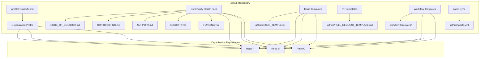
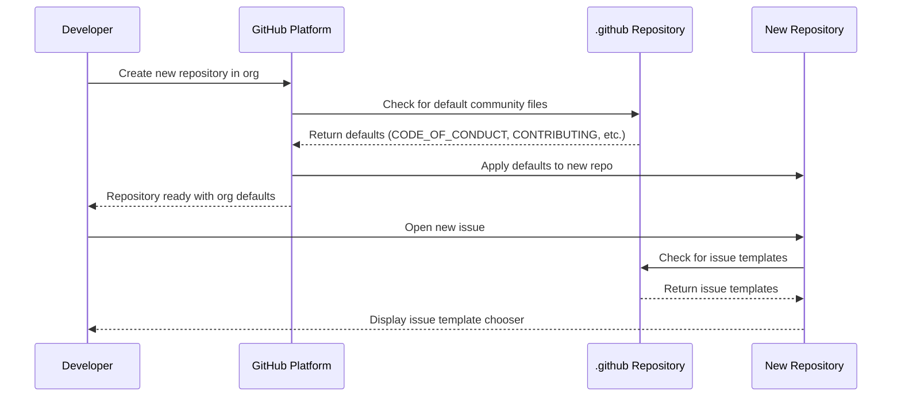
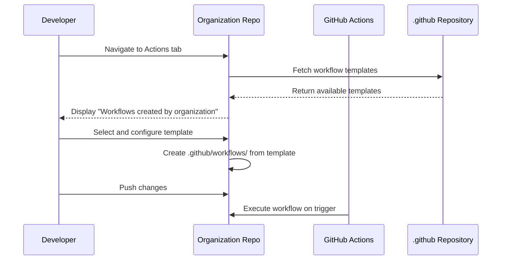
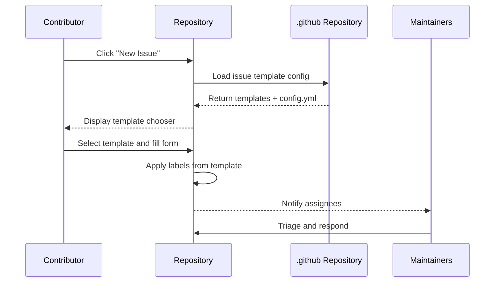

# Design Document: GitHub Organization Management (.github Repository)

## Overview

This design covers the setup and structure of a `.github` repository for a GitHub organization. The `.github` repository serves as the central configuration hub that provides default community health files, issue/PR templates, reusable workflow templates, organization profile content, and security policies that apply across all repositories in the organization.

The repository follows GitHub's convention where files placed in a `.github` repository automatically apply as defaults to all organization repositories that don't define their own versions. This approach reduces duplication, enforces consistency, and simplifies governance across the entire organization.

The design prioritizes maintainability, clear contribution guidelines, and automated enforcement of standards through GitHub Actions workflow templates.

## Architecture



## Sequence Diagrams

### New Repository Inherits Defaults



### Workflow Template Adoption



### Issue Lifecycle with Templates



## Components and Interfaces

### Component 1: Organization Profile

**Purpose**: Provides the public-facing README displayed on the organization's GitHub profile page.

**Interface**:
```pascal
STRUCTURE OrganizationProfile
  readme: MarkdownFile            // profile/README.md
  content: OrganizationInfo
END STRUCTURE

STRUCTURE OrganizationInfo
  name: String
  description: String
  mission: String
  links: List<URL>
  badges: List<Badge>
  team_highlights: List<TeamMember>
END STRUCTURE
```

**Responsibilities**:
- Display organization identity and mission
- Provide quick links to key repositories
- Showcase organization badges and status
- Guide visitors to contribution opportunities

### Component 2: Community Health Files

**Purpose**: Default files that establish contribution standards, codes of conduct, and support channels across all repositories.

**Interface**:
```pascal
STRUCTURE CommunityHealthFiles
  code_of_conduct: MarkdownFile   // CODE_OF_CONDUCT.md
  contributing: MarkdownFile       // CONTRIBUTING.md
  support: MarkdownFile            // SUPPORT.md
  security: MarkdownFile           // SECURITY.md
  funding: YAMLFile                // FUNDING.yml
END STRUCTURE
```

**Responsibilities**:
- Define behavioral expectations for contributors
- Document contribution workflows and standards
- Specify support channels and escalation paths
- Outline security vulnerability reporting process
- Configure funding/sponsorship links

### Component 3: Issue and PR Templates

**Purpose**: Structured templates that ensure consistent, high-quality issue reports and pull requests.

**Interface**:
```pascal
STRUCTURE IssueTemplateSystem
  config: TemplateConfig           // .github/ISSUE_TEMPLATE/config.yml
  templates: List<IssueTemplate>   // .github/ISSUE_TEMPLATE/*.yml
  pr_template: MarkdownFile        // .github/PULL_REQUEST_TEMPLATE.md
END STRUCTURE

STRUCTURE IssueTemplate
  name: String
  description: String
  title_prefix: String
  labels: List<String>
  assignees: List<String>
  body: List<FormElement>
END STRUCTURE

STRUCTURE FormElement
  VARIANT Input(label, description, placeholder, required)
  VARIANT Textarea(label, description, placeholder, required)
  VARIANT Dropdown(label, description, options, required)
  VARIANT Checkboxes(label, description, options, required)
  VARIANT Markdown(content)
END STRUCTURE
```

**Responsibilities**:
- Guide reporters to provide necessary information
- Auto-apply labels based on issue type
- Support GitHub Issue Forms (YAML-based)
- Provide external link options in template chooser
- Standardize PR descriptions with checklists

### Component 4: Workflow Templates

**Purpose**: Reusable GitHub Actions workflow templates available to all organization repositories.

**Interface**:
```pascal
STRUCTURE WorkflowTemplateSystem
  templates: List<WorkflowTemplate>   // workflow-templates/
  properties: List<PropertiesFile>     // workflow-templates/*.properties.json
END STRUCTURE

STRUCTURE WorkflowTemplate
  name: String
  description: String
  workflow_file: YAMLFile              // workflow-templates/{name}.yml
  properties_file: JSONFile            // workflow-templates/{name}.properties.json
  icon: String
  categories: List<String>
END STRUCTURE

STRUCTURE WorkflowProperties
  name: String
  description: String
  iconName: String
  categories: List<String>
  filePatterns: List<String>
END STRUCTURE
```

**Responsibilities**:
- Provide standardized CI/CD workflows
- Enforce organization-wide quality gates
- Offer opt-in workflow templates via Actions tab
- Support parameterization through properties files

### Component 5: Label Synchronization

**Purpose**: Maintain consistent labels across all organization repositories.

**Interface**:
```pascal
STRUCTURE LabelSyncSystem
  label_definitions: YAMLFile         // .github/labels.yml
  sync_workflow: WorkflowFile         // .github/workflows/label-sync.yml
END STRUCTURE

STRUCTURE LabelDefinition
  name: String
  color: HexColor
  description: String
  aliases: List<String>               // Old names to rename from
END STRUCTURE
```

**Responsibilities**:
- Define canonical label set for the organization
- Automatically sync labels to all repositories
- Handle label renames through aliases
- Run on schedule or manual trigger

## Data Models

### Model 1: Issue Template Configuration

```pascal
STRUCTURE IssueTemplateConfig
  blank_issues_enabled: Boolean
  contact_links: List<ContactLink>
END STRUCTURE

STRUCTURE ContactLink
  name: String
  url: URL
  about: String
END STRUCTURE
```

**Validation Rules**:
- `blank_issues_enabled` defaults to `false` to enforce template usage
- Each `contact_link` must have a valid URL
- Template names must be unique within the configuration

### Model 2: Workflow Template Properties

```pascal
STRUCTURE WorkflowTemplateProperties
  name: String
  description: String
  iconName: String
  categories: List<String>
  filePatterns: List<String>
END STRUCTURE
```

**Validation Rules**:
- `name` is required and must match the workflow filename
- `iconName` must be a valid Octicon name
- `categories` must use GitHub-recognized categories
- `filePatterns` determines when the template is suggested

### Model 3: Funding Configuration

```pascal
STRUCTURE FundingConfig
  github: List<String>                // GitHub Sponsors usernames
  open_collective: String
  ko_fi: String
  custom: List<URL>
END STRUCTURE
```

**Validation Rules**:
- At least one funding platform must be specified
- GitHub usernames must be valid GitHub accounts
- Custom URLs must use HTTPS protocol

## Algorithmic Pseudocode

### Repository File Resolution Algorithm

```pascal
ALGORITHM resolveDefaultFile(repo, fileType)
INPUT: repo (Repository), fileType (String)
OUTPUT: file (File or NULL)

BEGIN
  // Step 1: Check if repo has its own version
  localFile ← repo.findFile(fileType)

  IF localFile IS NOT NULL THEN
    RETURN localFile
  END IF

  // Step 2: Fall back to .github repository defaults
  orgDotGithub ← repo.organization.getDotGithubRepo()

  IF orgDotGithub IS NULL THEN
    RETURN NULL
  END IF

  defaultFile ← orgDotGithub.findFile(fileType)
  RETURN defaultFile
END
```

**Preconditions:**
- `repo` is a valid repository within the organization
- `fileType` is one of: CODE_OF_CONDUCT, CONTRIBUTING, SUPPORT, SECURITY, FUNDING, ISSUE_TEMPLATE, PULL_REQUEST_TEMPLATE

**Postconditions:**
- Returns the most specific file (local overrides org default)
- Returns NULL only if neither local nor org-level file exists

**Loop Invariants:** N/A

### Template Selection Algorithm

```pascal
ALGORITHM selectIssueTemplate(repo, userChoice)
INPUT: repo (Repository), userChoice (String)
OUTPUT: template (IssueTemplate or ExternalLink)

BEGIN
  // Step 1: Load template configuration
  config ← loadTemplateConfig(repo)

  ASSERT config IS NOT NULL

  // Step 2: Build available options
  options ← EMPTY LIST

  FOR EACH templateFile IN repo.issueTemplates DO
    ASSERT templateFile.isValid()
    template ← parseTemplate(templateFile)
    options.add(template)
  END FOR

  // Step 3: Add external contact links
  FOR EACH link IN config.contact_links DO
    options.add(link)
  END FOR

  // Step 4: Handle blank issues
  IF config.blank_issues_enabled THEN
    options.add(BlankIssueOption())
  END IF

  // Step 5: Match user choice
  selected ← options.findByName(userChoice)

  IF selected IS NULL THEN
    RETURN options[0]  // Default to first template
  END IF

  RETURN selected
END
```

**Preconditions:**
- `repo` has a valid ISSUE_TEMPLATE directory or inherits from .github repo
- `userChoice` is a non-empty string

**Postconditions:**
- Returns a valid template or external link
- Never returns NULL (falls back to first option)

**Loop Invariants:**
- All processed templates in `options` are valid and parseable
- Options list grows monotonically

### Label Synchronization Algorithm

```pascal
ALGORITHM syncLabels(orgRepo, targetRepos, labelDefinitions)
INPUT: orgRepo (Repository), targetRepos (List<Repository>), labelDefinitions (List<LabelDefinition>)
OUTPUT: syncReport (SyncReport)

BEGIN
  syncReport ← NEW SyncReport()

  FOR EACH repo IN targetRepos DO
    ASSERT repo.isAccessible()

    existingLabels ← repo.getLabels()

    // Step 1: Create or update labels
    FOR EACH definition IN labelDefinitions DO
      existingLabel ← existingLabels.findByName(definition.name)

      IF existingLabel IS NULL THEN
        // Check for aliases (renamed labels)
        aliasLabel ← NULL
        FOR EACH alias IN definition.aliases DO
          aliasLabel ← existingLabels.findByName(alias)
          IF aliasLabel IS NOT NULL THEN
            EXIT FOR
          END IF
        END FOR

        IF aliasLabel IS NOT NULL THEN
          // Rename existing label
          repo.renameLabel(aliasLabel, definition.name)
          repo.updateLabelColor(definition.name, definition.color)
          repo.updateLabelDescription(definition.name, definition.description)
          syncReport.addRenamed(repo, aliasLabel.name, definition.name)
        ELSE
          // Create new label
          repo.createLabel(definition.name, definition.color, definition.description)
          syncReport.addCreated(repo, definition.name)
        END IF
      ELSE
        // Update existing label if different
        IF existingLabel.color ≠ definition.color OR existingLabel.description ≠ definition.description THEN
          repo.updateLabel(definition.name, definition.color, definition.description)
          syncReport.addUpdated(repo, definition.name)
        END IF
      END IF
    END FOR

    syncReport.addRepoCompleted(repo)
  END FOR

  RETURN syncReport
END
```

**Preconditions:**
- `orgRepo` is the .github repository with admin access
- `targetRepos` are accessible repositories in the organization
- `labelDefinitions` is a non-empty, valid list with no duplicate names

**Postconditions:**
- All target repos have labels matching definitions
- Aliases are resolved (old names renamed to new names)
- `syncReport` contains complete audit trail of changes

**Loop Invariants:**
- For outer loop: all previously processed repos are fully synced
- For inner loop: all previously processed label definitions are applied to current repo

## Key Functions with Formal Specifications

### Function 1: validateTemplateStructure()

```pascal
PROCEDURE validateTemplateStructure(templateFile)
  INPUT: templateFile (YAMLFile)
  OUTPUT: ValidationResult (Valid or List<Error>)
```

**Preconditions:**
- `templateFile` exists and is readable
- `templateFile` contains valid YAML syntax

**Postconditions:**
- Returns `Valid` if template has all required fields (name, description, body)
- Returns list of specific errors if validation fails
- Does not modify the input file

**Loop Invariants:** N/A

### Function 2: resolveWorkflowTemplate()

```pascal
PROCEDURE resolveWorkflowTemplate(templateName, repoContext)
  INPUT: templateName (String), repoContext (Repository)
  OUTPUT: WorkflowFile (YAML content with substitutions applied)
```

**Preconditions:**
- `templateName` corresponds to an existing template in workflow-templates/
- A matching .properties.json file exists
- `repoContext` provides necessary substitution values

**Postconditions:**
- Returns valid GitHub Actions workflow YAML
- All `$default-branch` placeholders are replaced with actual default branch
- File patterns from properties match repository structure

**Loop Invariants:** N/A

### Function 3: generateCommunityHealthScore()

```pascal
PROCEDURE generateCommunityHealthScore(repo)
  INPUT: repo (Repository)
  OUTPUT: score (Integer 0-100), missing (List<String>)
```

**Preconditions:**
- `repo` is a valid, accessible repository in the organization

**Postconditions:**
- `score` is between 0 and 100 inclusive
- `missing` contains names of all absent community health files
- Score calculation: each present file contributes equally to total
- A repo with all files present scores 100

**Loop Invariants:** N/A

## Example Usage

### Example 1: Issue Template Form (YAML)

```pascal
// Bug Report Template Definition
SEQUENCE
  template ← NEW IssueTemplate
  template.name ← "Bug Report"
  template.description ← "Report a bug or unexpected behavior"
  template.title_prefix ← "[Bug]: "
  template.labels ← ["bug", "triage"]
  template.assignees ← []

  // Add form elements
  template.body.add(Markdown("## Bug Report"))
  template.body.add(Textarea(
    label: "Description",
    description: "A clear description of the bug",
    required: TRUE
  ))
  template.body.add(Textarea(
    label: "Steps to Reproduce",
    description: "Steps to reproduce the behavior",
    required: TRUE
  ))
  template.body.add(Dropdown(
    label: "Severity",
    options: ["Critical", "High", "Medium", "Low"],
    required: TRUE
  ))
  template.body.add(Input(
    label: "Version",
    placeholder: "e.g., 1.2.3",
    required: FALSE
  ))

  SAVE template TO ".github/ISSUE_TEMPLATE/bug-report.yml"
END SEQUENCE
```

### Example 2: Workflow Template Registration

```pascal
// CI Workflow Template Setup
SEQUENCE
  workflow ← NEW WorkflowTemplate
  workflow.name ← "Organization CI Pipeline"
  workflow.description ← "Standard CI pipeline with linting, testing, and security scanning"

  properties ← NEW WorkflowProperties
  properties.name ← "Organization CI Pipeline"
  properties.description ← "Standardized CI/CD pipeline for org repositories"
  properties.iconName ← "rocket"
  properties.categories ← ["CI", "Organization"]
  properties.filePatterns ← ["package.json", "Makefile", "Cargo.toml"]

  SAVE workflow TO "workflow-templates/ci-pipeline.yml"
  SAVE properties TO "workflow-templates/ci-pipeline.properties.json"
END SEQUENCE
```

### Example 3: Label Sync Execution

```pascal
// Synchronize labels across organization
SEQUENCE
  labelDefs ← LOAD ".github/labels.yml"
  targetRepos ← organization.getAllRepos()

  report ← syncLabels(dotGithubRepo, targetRepos, labelDefs)

  DISPLAY "Sync Complete:"
  DISPLAY "  Created: " + report.createdCount
  DISPLAY "  Updated: " + report.updatedCount
  DISPLAY "  Renamed: " + report.renamedCount
  DISPLAY "  Repos processed: " + report.repoCount
END SEQUENCE
```

## Correctness Properties

*A property is a characteristic or behavior that should hold true across all valid executions of a system — essentially, a formal statement about what the system should do. Properties serve as the bridge between human-readable specifications and machine-verifiable correctness guarantees.*

### Property 1: Funding URL HTTPS Validation

*For any* URL present in the FUNDING.yml configuration file, the URL SHALL use the HTTPS protocol. Non-HTTPS URLs SHALL be rejected with a validation error.

**Validates: Requirement 2.9**

### Property 2: Workflow Template Consistency

*For any* workflow template file (*.yml) in the `workflow-templates/` directory, there SHALL exist a corresponding properties file (*.properties.json) whose `name` field matches the workflow template filename (without extension), and the properties file SHALL contain valid values for display name, description, icon (valid Octicon name), categories, and filePatterns.

**Validates: Requirements 5.3, 5.4, 7.6**

### Property 3: No Hardcoded Secrets in Workflow Templates

*For any* workflow template file in the `workflow-templates/` directory, the file SHALL NOT contain hardcoded secret values. All secret references SHALL use the `${{ secrets.* }}` syntax exclusively.

**Validates: Requirement 5.8**

### Property 4: Label Sync Convergence

*For any* set of label definitions and any target repository state, after the label sync workflow executes successfully, the target repository SHALL contain labels matching all definitions exactly — missing labels are created, labels matching aliases are renamed to canonical names, and labels with divergent color or description are updated to match the definition.

**Validates: Requirements 6.2, 6.3, 6.4**

### Property 5: Sync Report Accuracy

*For any* label sync execution, the generated report's counts of created, updated, and renamed labels SHALL equal the actual number of create, update, and rename operations performed during that execution.

**Validates: Requirement 6.7**

### Property 6: Issue Template Structural Validity

*For any* issue template in the `.github/ISSUE_TEMPLATE/` directory, the template SHALL have a unique name (no two templates share the same name), a non-empty description field, and at least one Form_Element in its body. If any of these conditions are violated, the validator SHALL produce a descriptive error.

**Validates: Requirements 7.1, 7.2, 7.3**

### Property 7: Label Definition Validity

*For any* set of label definitions in `labels.yml`, no two labels SHALL share the same name when compared case-insensitively, and every label's color field SHALL match the hexadecimal pattern `^[0-9a-fA-F]{6}$`.

**Validates: Requirements 7.4, 7.5**

## Error Handling

### Error Scenario 1: Template Parse Failure

**Condition**: An issue template YAML file contains invalid syntax or missing required fields
**Response**: GitHub displays an error banner on the Issues page and falls back to blank issue creation
**Recovery**: Validate all templates with a CI workflow before merging changes to the .github repository

### Error Scenario 2: Label Sync Permission Denied

**Condition**: The sync workflow lacks write access to a target repository
**Response**: Log the failed repository, continue syncing remaining repositories
**Recovery**: Report permissions gaps in sync summary; org admin grants necessary permissions

### Error Scenario 3: Workflow Template Substitution Failure

**Condition**: A workflow template references `$default-branch` but the target repo has a non-standard default branch configuration
**Response**: GitHub substitutes the actual default branch name at template adoption time
**Recovery**: No action needed; GitHub handles substitution automatically

### Error Scenario 4: Profile README Too Large

**Condition**: The profile/README.md exceeds GitHub's rendering size limit
**Response**: GitHub truncates the rendered output with a "View full README" link
**Recovery**: Keep profile README concise; link to detailed documentation elsewhere

### Error Scenario 5: Conflicting Local Override

**Condition**: A repository defines its own community health file that conflicts with org standards
**Response**: Local file always takes precedence (by GitHub design)
**Recovery**: Use a compliance audit workflow to detect and report deviations from org standards

## Testing Strategy

### Unit Testing Approach

- Validate YAML syntax for all template files using a YAML linter
- Verify issue template forms render correctly by testing against GitHub's schema
- Validate label definitions have unique names and valid hex colors
- Test workflow template properties files match their workflow counterparts
- Verify Markdown files render without errors

### Property-Based Testing Approach

**Property Test Library**: Custom validation scripts (shell/Python)

- **Template Name Uniqueness**: For any set of templates, no two templates produce the same chooser entry
- **Label Color Validity**: For all label definitions, the color field matches the pattern `^[0-9a-fA-F]{6}$`
- **URL Validity**: For all URLs in configuration files, each URL is well-formed and uses HTTPS
- **File Path Consistency**: For all workflow templates, the filename (without extension) matches the properties file name

### Integration Testing Approach

- Deploy .github repository to a test organization
- Create a new repository and verify defaults are inherited
- Open an issue and verify templates appear correctly
- Adopt a workflow template and verify it executes successfully
- Run label sync and verify all target repos are updated
- Verify profile README renders on organization page

## Performance Considerations

- **Label Sync Rate Limiting**: GitHub API has rate limits; the sync workflow should batch requests and include exponential backoff for large organizations (100+ repos)
- **Template Loading**: Keep issue templates concise to ensure fast rendering in the template chooser
- **Workflow Template Size**: Templates should be focused and composable rather than monolithic to reduce adoption complexity
- **Profile README**: Keep under 5KB for fast rendering on the organization profile page

## Security Considerations

- **SECURITY.md**: Must include clear vulnerability reporting instructions with a private disclosure channel (GitHub Security Advisories or email)
- **Workflow Templates**: Should not include hardcoded secrets; reference organization-level secrets via `${{ secrets.* }}` syntax
- **Label Sync Permissions**: The sync workflow needs minimal permissions (issues: write); avoid granting admin access
- **Funding Configuration**: Only include verified funding platforms to prevent impersonation
- **Branch Protection**: The .github repository itself should have branch protection rules requiring PR reviews for changes

## Dependencies

- **GitHub Platform**: Core functionality depends on GitHub's `.github` repository convention
- **GitHub Actions**: Required for workflow templates and label synchronization
- **GitHub Issue Forms**: Required for YAML-based issue templates (generally available)
- **GitHub Security Advisories**: Required for private vulnerability reporting
- **GitHub Sponsors**: Optional, for funding configuration
- **actions/labeler or similar**: For automated label sync workflows (e.g., `EndBug/label-sync`)
